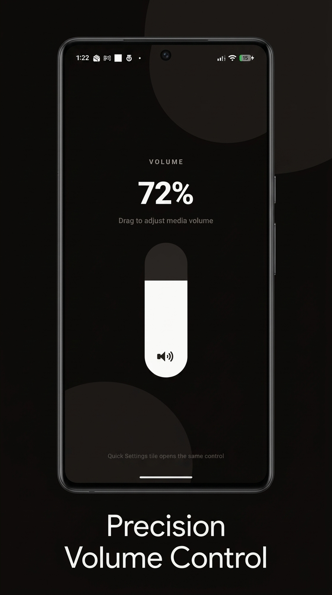
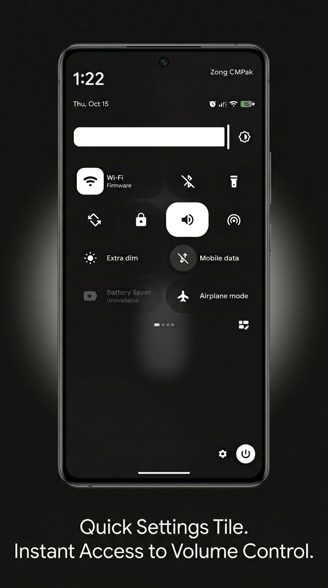

# Volume Slider

A lightweight Android application that adds a **Volume Quick Settings tile** and an in-app iOS-style vertical volume control.

The app is built with **Expo + React Native** and uses a native Android `TileService` plus `AudioManager` to control media volume from Quick Settings.

> **Android only.** iOS is not supported.

## Screenshots

<!-- Add screenshots later. Suggested layout: app home, Quick Settings tile, system volume UI. -->

| App home | Quick Settings tile |
| --- | --- |
|  |  |

> Place your images at `docs/screenshots/app-home.png` and `docs/screenshots/quick-settings-tile.png` (or update the paths above).

## Features

- 🔊 Control media volume from the app
- 🎚️ Tall fill-style volume cylinder (iOS Control Center inspired)
- ⚡ Custom Android Quick Settings tile
- 📱 Native Android implementation using Kotlin
- ⚛️ React Native / Expo-based UI
- 🎵 Adjusts `AudioManager.STREAM_MUSIC` volume

## Download

Download the latest APK from the GitHub Releases page:

**[Download the latest APK](https://github.com/azhar021/volume-slider-tile/releases)**

The release page will be updated whenever a new version is published.

## Requirements

- Node.js 18+
- Android Studio
- Android SDK
- Android device or emulator
- Developer Options enabled when testing on a physical device

## Getting Started

Clone the repository and install the dependencies:

```bash
git clone https://github.com/azhar021/volume-slider-tile.git
cd volume-slider-tile
npm install
```

## Run on Android

Build and install the application on a connected Android device:

```bash
npx expo run:android
```

This builds the native Android project and installs the application.

After installation, add the **Volume** tile from Android Quick Settings.

## How It Works

The Quick Settings tile uses Android's `TileService` and `AudioManager` to open the system media volume UI.

The basic flow is:

```text
Quick Settings
      │
      ▼
Volume Tile
      │
      ▼
TileService.onClick()
      │
      ▼
AudioManager.adjustStreamVolume(
  STREAM_MUSIC,
  ADJUST_SAME,
  FLAG_SHOW_UI
)
      │
      ▼
System volume slider
```

The in-app screen uses a custom vertical pill slider that reads and writes media volume through a native React Native module (`VolumeTileModule`).

## Quick Settings Tile

After installing the application:

1. Open the Android Quick Settings panel.
2. Tap the **Edit** button.
3. Find **Volume**.
4. Add the tile to Quick Settings.
5. Tap the tile to open the system volume control.

If the tile does not appear immediately after installation, remove it from Quick Settings and add it again.

## Volume Control

The native Android tile is implemented using:

```text
VolumeTileService
```

On tap, the service calls:

```kotlin
audioManager.adjustStreamVolume(
    AudioManager.STREAM_MUSIC,
    AudioManager.ADJUST_SAME,
    AudioManager.FLAG_SHOW_UI
)
```

No root access is required. The app only changes media (`STREAM_MUSIC`) volume.

## Building a Release APK

To build a release APK locally:

### Linux / macOS

```bash
cd android
./gradlew assembleRelease
```

### Windows

```powershell
cd android
.\gradlew.bat assembleRelease
```

The generated APK will be available at:

```text
android/app/build/outputs/apk/release/app-release.apk
```

Release signing uses `android/keystore.properties` and `android/release-keystore.jks` (kept out of Git). Copy your local keystore files before building a signed release.

## Project Structure

```text
.
├── App.tsx
├── app.json
├── docs/
│   └── screenshots/          # Add screenshots here
├── android/
│   └── app/
│       └── src/
│           └── main/
│               ├── java/
│               ├── res/
│               └── AndroidManifest.xml
├── index.ts
├── package.json
├── README.md
└── tsconfig.json
```

## Tech Stack

- **React Native**
- **Expo**
- **TypeScript**
- **Kotlin**
- **Android SDK**
- **Android AudioManager**
- **Android Quick Settings TileService**

## Open Source

This project is open source. The source code is available in this repository for developers to inspect, learn from, modify, and contribute to.

The project demonstrates how to integrate **native Android functionality into an Expo/React Native application**, including:

- Android Quick Settings tiles
- Native Kotlin services
- Media volume control with `AudioManager`
- Communication between React Native and native Android functionality
- Custom gesture-driven UI for volume adjustment

## Limitations

- Android only
- Quick Settings tile opens the system volume UI (not a custom embedded QS slider)
- Only controls media (`STREAM_MUSIC`) volume
- Quick Settings tile appearance and behavior are controlled by Android System UI
- Device behavior may vary between Android versions and manufacturers

## Contributing

Contributions, bug reports, and suggestions are welcome.

If you find a bug or have an idea for an improvement, please open an issue or submit a pull request.

## License

This project is open source. See the `LICENSE` file for details.
